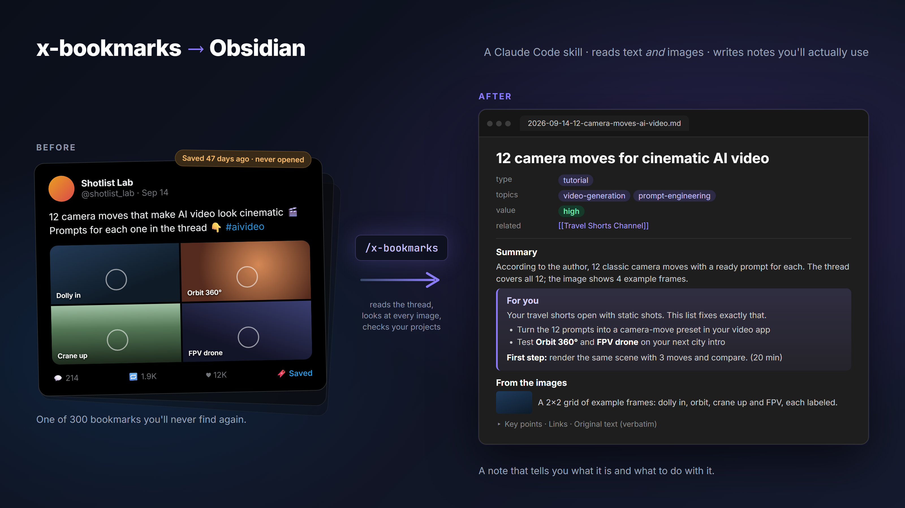

# x-bookmarks → Obsidian

**You bookmark great stuff on X. Then you never open it again.**

This is a [Claude Code](https://claude.com/claude-code) skill that downloads your X (Twitter) bookmarks
and turns each one into a clean, searchable Obsidian note: what it is, why it matters, what the images
actually show, and a personal **"For you"** section that tells you how to use it in *your* work.

<!-- TODO: before/after image: raw bookmark on the left, finished note on the right -->


## What a note gets

- **Summary, why it matters, key points.** Claims are attributed ("the author says"), never stated as fact.
- **For you.** Based on a short profile of you and the projects in your vault: what you can do with it,
  which of your projects it helps, and a 15-minute first step. If it isn't relevant, it says so instead
  of forcing a connection.
- **From the images.** Claude actually looks at every image. Screenshots, tables, diagrams and code are
  described and copied into the vault; memes are skipped.
- **Original text, verbatim.** Threads, quoted tweets and linked X articles included. Nothing is shortened.
- **Translation.** Content in languages you don't read is translated to English, with the original kept
  in a collapsed callout.
- **Clean frontmatter.** Type, topics from your own topic dictionary, tags, value (high / medium / low),
  links (expanded, no t.co), related projects. Ready for Dataview.
- **Safety checks.** Duplicates are skipped, wikilinks are checked against your vault, and a QA script
  runs at the end. Your raw downloads are never modified.

Notes can be written in **English** or **Turkish** (other languages: PRs welcome).

## How it works

```
X bookmarks ──birdmarks──▶ bookmarks/ (raw, read-only)
                               │  bookmarks-sync.ps1: only new ones, optionally only selected X folders
                               ▼
                           pending/ ──Claude reads text + images──▶ data file
                                                                       │  build_notes.py
                                                                       ▼
                                              Obsidian vault: note + article note + images
```

Claude does the parts that need judgment (reading, looking at images, summarizing, "For you").
Small Python scripts do the mechanical parts, so the original text and frontmatter are always exact.

## Requirements

- **Windows** with PowerShell (the sync script is PowerShell; tested on Windows 11)
- [Claude Code](https://claude.com/claude-code)
- Python 3.9+
- An [Obsidian](https://obsidian.md) vault
- **birdmarks**: the CLI that exports X bookmarks to markdown. <!-- TODO: link to birdmarks -->
  It reads your X login from your browser (Firefox, Chrome or Safari), so you must be logged in to X there.

## Install

1. **birdmarks:** download it and put `birdmarks-win-x64.exe` in a folder of its own, e.g. `C:\x-bookmarks`.
2. **The skill**, as a Claude Code plugin:
   ```
   /plugin marketplace add ugurtekdal/x-bookmarks-obsidian
   /plugin install x-bookmarks@x-bookmarks-obsidian
   ```
   Or copy `skills/x-bookmarks` into `~/.claude/skills/`.
3. **Setup:** in Claude Code, run
   ```
   /x-bookmarks setup
   ```
   Claude asks for your vault path, note language, X folders and browser, writes
   `~/.x-bookmarks/config.json`, and helps you fill in `_profile.md`.

## Use

```
/x-bookmarks
```

New bookmarks are downloaded and processed. Say "without downloading" to only process what is already
pending. At the end you get a report: notes written, translated, low-value ones, duplicates, new topics.

**Tip:** create an X bookmark folder (e.g. "To vault") and set `x_folders` to it, so only the bookmarks you
really want end up as notes.

## Config

`~/.x-bookmarks/config.json` (or the path in `X_BOOKMARKS_CONFIG`):

| Key | Example | Meaning |
|---|---|---|
| `tool_dir` | `C:/x-bookmarks` | birdmarks and its working folders |
| `birdmarks_exe` | *(optional)* | Full path to birdmarks if it's not in `tool_dir` |
| `vault` | `C:/Users/you/MyVault` | Obsidian vault root |
| `target` | `Resources/X Bookmarks` | Notes folder inside the vault |
| `note_language` | `en` | `en` or `tr` |
| `keep_languages` | `["en"]` | Languages kept as is; everything else is translated to English |
| `x_folders` | `["To vault"]` | Only these X bookmark folders; `[]` = all bookmarks |
| `cookie_source` | `firefox` | Browser you're logged in to X with |

## Cost and limits

- Each bookmark is read by Claude, images included, so processing uses tokens. A big backlog costs a lot:
  during setup you can skip existing bookmarks and start fresh.
- With folder filtering, downloading takes a while (the folder map is rebuilt every run, ~15-25 min
  for 90 bookmarks). It runs in the background.
- X rate-limits downloads. Whatever arrived is processed and the rest comes next run.
- When a tweet says "prompt in the comments", the author's reply is often missing. The skill flags these
  so you can check them yourself.

## Disclaimer

Provided as is, without support or warranty. birdmarks uses your own logged-in browser session to read
**your own** bookmarks. Use it with your own account and at your own risk, and respect X's terms of service.

## Author

Made by **Mehmet Uğur Tekdal** · Time Doctor ([@timedoctor_nft](https://x.com/timedoctor_nft)).
Built because I needed it, and I've used it ever since.

## License

[MIT](LICENSE)
